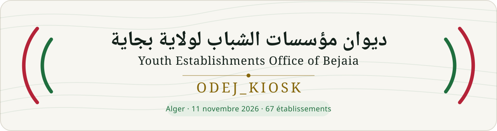
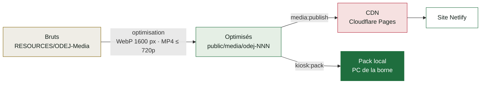
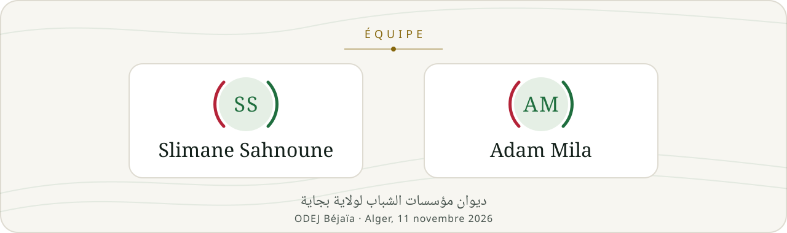

<div align="center">



### Borne tactile de l'ODEJ Béjaïa pour le salon des établissements de jeunesse

Une carte 3D de la wilaya de Béjaïa et de ses 67 établissements,
en arabe et en anglais, en portrait et en paysage.

<a href="https://odej-bejaia.netlify.app"></a>
<a href="https://github.com/simoosh/ODEJ_KIOSK/actions/workflows/ci.yml"></a>


[État du projet](#-état-du-projet) · [Fonctionnalités](#-fonctionnalités) · [Démarrage](#-démarrage) · [Arborescence](#-arborescence) · [Médias](#-médias) · [Workflow git](#-workflow-git) · [Déploiement](#-déploiement) · [Équipe](#-équipe)

</div>

---

> [!IMPORTANT]
> Les agents et les contributeurs lisent d'abord [CLAUDE.md](CLAUDE.md) et [teamwork/README.md](teamwork/README.md), puis la fin de [teamwork/Update.md](teamwork/Update.md).

| | |
|---|---|
| 🏛️ **Organisme** | ديوان مؤسسات الشباب لولاية بجاية · Youth Establishments Office of Bejaia |
| 📅 **Événement** | Salon des établissements de jeunesse, Alger, 11 novembre 2026 |
| 🗺️ **Contenu** | 67 établissements · 7 catégories · 43 communes et lieux-dits |
| 🌐 **Langues** | arabe (par défaut, RTL) et anglais (LTR) |
| 🖥️ **Écrans** | portrait et paysage : 1920×1080, 1080×1920, 1280×1024, 1024×768 |
| ☁️ **Hébergement** | Netlify pour l'application, Cloudflare Pages pour les médias, pack local sur la borne |

---

## 📊 État du projet

_Au 3 novembre 2026._

### Application : étapes 1 à 8 livrées

| | Étape | PR |
|:-:|---|:-:|
| 🟢 | **1.** Hygiène du dépôt, CI et configuration Netlify | [#5](https://github.com/simoosh/ODEJ_KIOSK/pull/5) |
| 🟢 | **2.** Données séparées des médias, corrections d'audit | [#8](https://github.com/simoosh/ODEJ_KIOSK/pull/8) |
| 🟢 | **2b.** Chaîne médias, URL du CDN et pack borne | [#9](https://github.com/simoosh/ODEJ_KIOSK/pull/9), [#15](https://github.com/simoosh/ODEJ_KIOSK/pull/15) |
| 🟢 | **3.** Performances de rendu | [#12](https://github.com/simoosh/ODEJ_KIOSK/pull/12), [#16](https://github.com/simoosh/ODEJ_KIOSK/pull/16) |
| 🟢 | **4.** Relief auto-hébergé | [#19](https://github.com/simoosh/ODEJ_KIOSK/pull/19), [#22](https://github.com/simoosh/ODEJ_KIOSK/pull/22) |
| 🟢 | **5.** Fonds de carte | [#20](https://github.com/simoosh/ODEJ_KIOSK/pull/20) |
| 🟢 | **6.** Cadrage, masque, visite de l'accueil, brouillard progressif | [#23](https://github.com/simoosh/ODEJ_KIOSK/pull/23), [#27](https://github.com/simoosh/ODEJ_KIOSK/pull/27), [#28](https://github.com/simoosh/ODEJ_KIOSK/pull/28) |
| 🟢 | **7.** Établissement phare | [#30](https://github.com/simoosh/ODEJ_KIOSK/pull/30) |
| 🟢 | **8.** Nettoyage et finitions | [#31](https://github.com/simoosh/ODEJ_KIOSK/pull/31) |

### Données

| Catégorie | Établissements |
|---|--:|
| دار الشباب · Youth centre | 33 |
| مركب رياضي جواري · Local sports complex | 18 |
| بيت الشباب · Youth hostel | 9 |
| قاعة متعددة الخدمات · Multipurpose hall | 2 |
| مخيم الشباب · Youth camp | 2 |
| مؤسسة شبانية · Youth facility | 2 |
| مركز الترفيه العلمي · Science leisure centre | 1 |
| **Total** | **67** |

### Collecte des médias

**34 établissements sur 67** : 1117 photos, 64 vidéos, 502,2 MiB sur un budget de 3 GiB.

```
██████████░░░░░░░░░░  51 %
```

Chaque lot passe par les mêmes étapes : collecte depuis les pages officielles, sélection, optimisation (WebP 1600 px, MP4 ≤ 720p), contrôle `media:check --hash`, PR de données, puis publication sur le CDN.

| Lot | Fusion | Établissements | Photos | Vidéos | MiB | Cumul | CDN | PR |
|:-:|---|---|--:|--:|--:|:-:|---|:-:|
| 1 | 30 oct. | odej-003 | 35 | 6 | 98,9 | 1 | 1re publication ([#11](https://github.com/simoosh/ODEJ_KIOSK/pull/11)) | [#1](https://github.com/simoosh/ODEJ_KIOSK/pull/1) |
| 2 | 30 oct. | odej-001 | 23 | 2 | 16,2 | 2 | 1re publication ([#11](https://github.com/simoosh/ODEJ_KIOSK/pull/11)) | [#3](https://github.com/simoosh/ODEJ_KIOSK/pull/3) |
| 3 | 31 oct. | odej-004, 021 | 57 | 2 | 14,2 | 4 | 1re publication ([#11](https://github.com/simoosh/ODEJ_KIOSK/pull/11)) | [#4](https://github.com/simoosh/ODEJ_KIOSK/pull/4), [#10](https://github.com/simoosh/ODEJ_KIOSK/pull/10) |
| 4 | 1er nov. | odej-005 | 27 | 0 | 5,7 | 5 | 2e publication ([#18](https://github.com/simoosh/ODEJ_KIOSK/pull/18)) | [#17](https://github.com/simoosh/ODEJ_KIOSK/pull/17) |
| 5 | 1er nov. | odej-007 à 010 | 109 | 6 | 55,4 | 9 | 3e publication | [#21](https://github.com/simoosh/ODEJ_KIOSK/pull/21) |
| 6 | 1er nov. | odej-011, 012, 013, 016, 017, 041 | 160 | 9 | 66,8 | 15 | 4e publication | [#24](https://github.com/simoosh/ODEJ_KIOSK/pull/24) |
| 7 | 1er nov. | odej-018 à 020, 022 à 027 | 318 | 25 | 120,3 | 24 | 5e publication | [#25](https://github.com/simoosh/ODEJ_KIOSK/pull/25) |
| 8 | 2 nov. | odej-028 à 036, 038 | 388 | 14 | 124,6 | 34 | 6e publication | [#29](https://github.com/simoosh/ODEJ_KIOSK/pull/29) |
| | | **Total** | **1117** | **64** | **502,2** | **34 / 67** | | |

Les comptes de photos excluent la couverture, et les tailles incluent la couverture, sans les vignettes. Les tailles par lot sont arrondies : leur somme donne 502,1 MiB.

Autres PR de données : contacts e-mail et site web ([#14](https://github.com/simoosh/ODEJ_KIOSK/pull/14)), tableau des établissements collectés ([#26](https://github.com/simoosh/ODEJ_KIOSK/pull/26)). Le tableau par établissement est dans [teamwork/Update.md](teamwork/Update.md), et les problèmes ouverts dans [teamwork/Data.md](teamwork/Data.md).

### Reste à faire

- [ ] Collecter les médias des 33 établissements restants.
- [ ] Faire valider par l'ODEJ les graphies anglaises des noms, translittérées pour l'instant.
- [ ] Faire relire par l'ODEJ le texte « على جناحنا » / « On our stand ».
- [ ] Recevoir le programme réel des activités. D'ici là, les activités affichées viennent du type d'établissement.
- [ ] Ajouter le logo de l'ODEJ : l'accueil lui réserve déjà un emplacement (`organization.logo`).

---

## ✨ Fonctionnalités

| | |
|---|---|
| 🏔️ **Carte 3D** | relief auto-hébergé, brouillard qui s'épaissit hors de la wilaya, fonds « carte » et « satellite » avec un tracé simplifié de secours |
| 🌥️ **Accueil** | texte centré sur des nuages, carte qui tourne en dessous, deuxième bouton vers l'établissement phare |
| 🔎 **Recherche** | clavier virtuel, suggestions par établissement, commune, type ou activité |
| 📋 **Fiche** | description, activités, contacts, horaires, galerie photos et vidéos avec gestes de balayage, QR code |
| ⭐ **Établissement phare** | marqueur doré avec son nom, en tête de liste et de la recherche. Il suit le champ `featured` des données, aucun identifiant n'est dans le code |
| ⏱️ **Veille** | après 2 minutes sans contact, un avertissement de 10 secondes, puis retour à l'accueil avec réinitialisation de la langue, du fond et du relief. Une vidéo en cours de lecture retarde la veille |
| 🧪 **Outils** | `?sim=1` simulateur d'écrans, `?debug=1` panneau de performance, `?quality=low` niveau de qualité imposé (voir [docs/PERF.md](APP/odej-kiosk/docs/PERF.md)) |

---

## 🚀 Démarrage

Node 22 est requis (voir `.nvmrc`).

```bash
cd APP/odej-kiosk
npm ci
npm run dev
```

L'application s'ouvre sur `http://localhost:5173`. `npm ci` active aussi le hook `.githooks/commit-msg` avec le script `prepare`.

| Commande (dans `APP/odej-kiosk`) | Rôle |
|---|---|
| `npm run lint` | ESLint |
| `npm run typecheck` | TypeScript |
| `npm test` | tests unitaires (Vitest) |
| `npm run build` | valide les données, vérifie les types, construit `dist/` |
| `npm run validate:data` | valide `public/data/odej-bejaia.json` (schéma et cohérence interne) |
| `npm run format` | Prettier. Reformate tout le code : à ne lancer qu'après accord, dans un commit `style:` séparé |
| `npm run media:check` | contrôle les médias. Les autres outils sont dans [docs/MEDIA.md](APP/odej-kiosk/docs/MEDIA.md) |
| `npm run kiosk:pack` | produit `kiosk-pack/`, le dossier à copier sur le PC de la borne |

---

## 🗂️ Arborescence

```
ODEJ_KIOSK/
├─ .github/                CI (lint, typecheck, test, build) et illustrations du README
├─ .githooks/commit-msg    refuse les lignes d'attribution dans les commits
├─ APP/odej-kiosk/         l'application (ne pas déplacer)
│  ├─ public/data/         données et schéma
│  ├─ public/media/        médias optimisés : binaires ignorés, media.json suivi
│  ├─ public/terrain/      tuiles de relief, construites par tools/dem
│  ├─ scripts/             scripts de build (validation des données, index des médias)
│  ├─ src/                 code : components/, map/, i18n/, data/, lib/, styles/
│  ├─ tests/unit/          tests unitaires
│  └─ docs/                DATA, MEDIA, PERF, VERIFICATION, traçabilité des médias
├─ tools/                  hors application : data/, dem/, media/collect/, media/pipeline/
├─ RESOURCES/ODEJ-Media/   médias bruts : seuls info.json et manifest.json sont suivis
├─ teamwork/               règles partagées, journal des agents, registre des données
└─ netlify.toml            déploiement
```

### Répartition des fichiers

| Zone | Responsable |
|---|---|
| `APP/odej-kiosk/src/**`, `scripts/**`, configuration, CI, Netlify, `tools/media/pipeline/**`, `tools/dem/**`, `tools/data/**` | propriétaire (agent applicatif) |
| `RESOURCES/**`, `tools/media/collect/**`, `APP/odej-kiosk/docs/media/**`, `APP/odej-kiosk/public/media/odej-NNN/**` | collègue (agent données) |
| `APP/odej-kiosk/public/data/odej-bejaia.json` et son schéma | partagé : prévenir dans `teamwork/Update.md` avant d'éditer |
| `teamwork/**` | tout le monde. `Update.md` se modifie en ajout seulement |

---

## 🖼️ Médias

Les photos et les vidéos ne passent ni par git ni par Netlify.



> [!WARNING]
> Aucune photo ni vidéo n'entre dans git. Les règles et les budgets sont dans [teamwork/README.md](teamwork/README.md), section 4.

---

## 🌿 Workflow git

- Une tâche, une branche, une PR. Branches : `step/NN-nom` pour l'application, `data/...` pour les données.
- Pas de push direct sur `main`, sauf une entrée dans `teamwork/Update.md`. Jamais de force-push sur `main`.
- Commits au format Conventional Commits, sujet en anglais à l'impératif.
- Avant une PR : `git fetch origin && git rebase origin/main`, puis `npm ci && npm run lint && npm run typecheck && npm test && npm run build`.
- La CI doit être verte. Le propriétaire ou le collègue fusionne : un agent ne fusionne jamais.

---

## 📦 Déploiement

Netlify construit l'application depuis `main`, avec un aperçu de déploiement sur chaque PR. La configuration est dans `netlify.toml` (`base = "APP/odej-kiosk"`). Le site est en ligne sur [odej-bejaia.netlify.app](https://odej-bejaia.netlify.app).

Pour reproduire le build Netlify en local, depuis la racine du dépôt, après `npm ci` dans `APP/odej-kiosk` :

```bash
npx netlify-cli build --offline
```

`--offline` évite d'avoir à lier le dossier à un site Netlify : sans cette option, la commande exige un site lié.

### Mode borne

Au salon, la borne exécute un pack local, pas le site Netlify. `npm run kiosk:pack` produit `kiosk-pack/`, à copier sur le PC de la borne. Node.js et Google Chrome doivent y être installés. `start-kiosk.bat` lance le serveur local, puis Chrome avec ces options :

```
--kiosk --no-first-run --disable-pinch --overscroll-history-navigation=0 --user-data-dir=chrome-profile
```

Détails dans [docs/MEDIA.md](APP/odej-kiosk/docs/MEDIA.md).

---

## 👥 Équipe

<div align="center">



</div>
